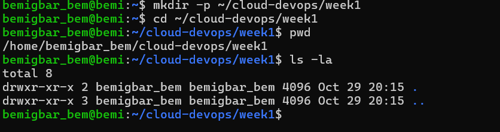
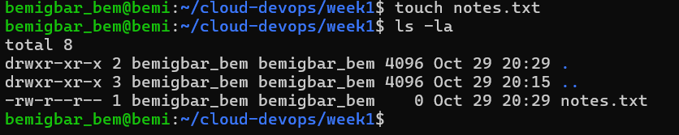
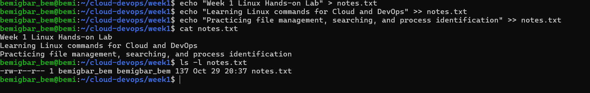
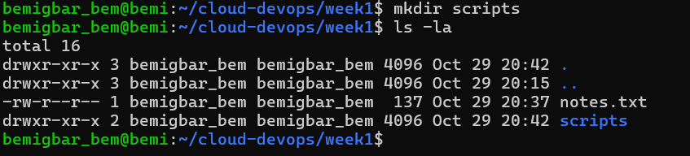
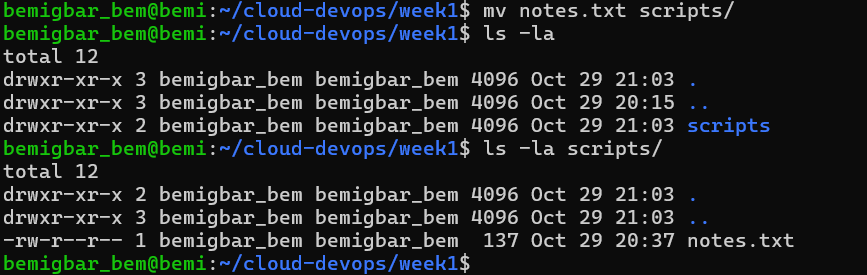
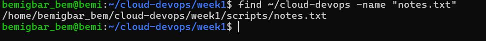
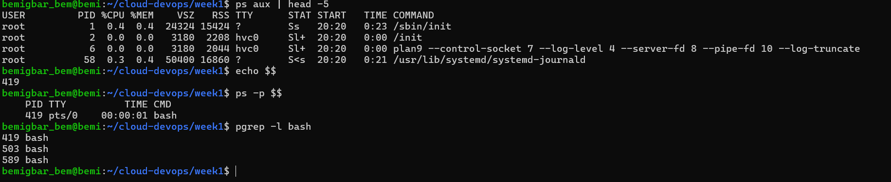

#Week 1 Linux Hands-on Lab: 
Cloud and DevOps track, Week 1. This lab builds a small project workspace in Linux (Ubuntu on WSL2) and practices core shell commands: creating directories and files, moving files, searching, and identifying processes. 
## Project Structure
week1/
├── README.md
├── scripts/
│ └── notes.txt
└── screenshots/
├── 01-mkdir.png
├── 02-touch.png
├── 03-add-notes.png
├── 04-mkdir-scripts.png
├── 05-mv-notes.png
├── 06-find-notes.png
└── 07-process-pid.png 

## Tasks and commands

### 1. Create the `~/cloud-devops/week1` directory

```bash
mkdir -p ~/cloud-devops/week1
cd ~/cloud-devops/week1
pwd
ls -la
```

`mkdir -p` creates the directory and any missing parent folders. `pwd` prints the current location and `ls -la` lists contents with details.



### 2. Create a file named `notes.txt`

```bash
touch notes.txt
ls -la
```

`touch` creates an empty file.



### 3. Add text to `notes.txt`

```bash
echo "Week 1 Linux Hands-on Lab" > notes.txt
echo "Learning Linux commands for Cloud and DevOps" >> notes.txt
echo "Practicing file management, searching, and process identification" >> notes.txt
cat notes.txt
```

`>` creates or overwrites the file, `>>` appends a line, and `cat` prints the contents.



### 4. Create a directory named `scripts`

```bash
mkdir scripts
ls -la
```



### 5. Move `notes.txt` into `scripts/`

```bash
mv notes.txt scripts/
ls -la
ls -la scripts/
```

`mv` moves the file. The listings show it is gone from `week1` and now inside `scripts`.



### 6. Search for `notes.txt`

```bash
find ~/cloud-devops -name "notes.txt"
```

`find` searches a directory tree by name. It returns `/home/bemigbar_bem/cloud-devops/week1/scripts/notes.txt`.



### 7. Find a running process and its PID

```bash
ps aux | head -5
echo $$
ps -p $$
pgrep -l bash
```

`ps aux` lists running processes, `echo $$` prints the PID of the current shell, `ps -p $$` shows that process by PID, and `pgrep -l bash` finds processes by name and prints their PIDs.



## Summary of commands used

| Command | Purpose |
|---------|---------|
| `mkdir -p` | Create directories (including parents) |
| `cd`, `pwd`, `ls -la` | Navigate and inspect |
| `touch` | Create an empty file |
| `echo`, `>`, `>>`, `cat` | Write, append, and read text |
| `mv` | Move files |
| `find` | Search for files |
| `ps`, `pgrep` | Inspect processes and PIDs |
